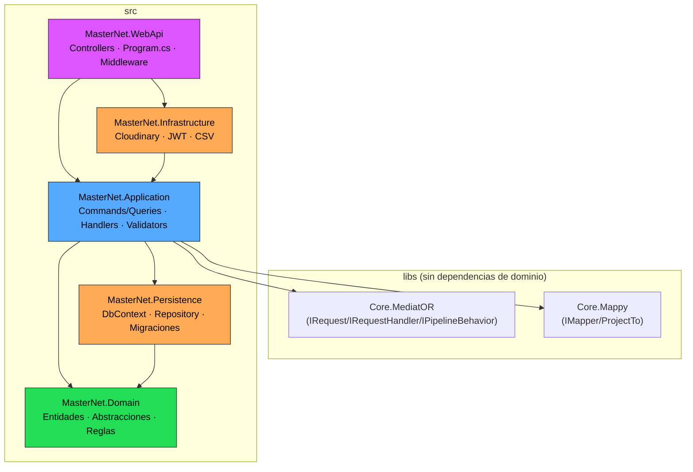
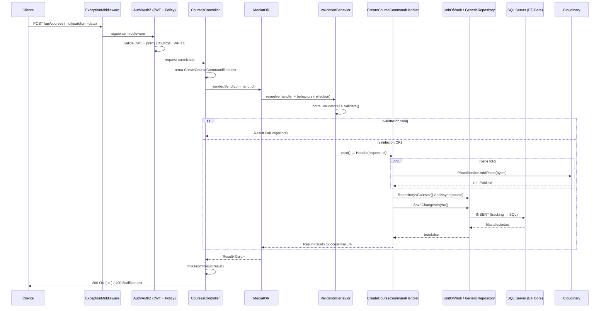

# MasterNet — Arquitectura

## Resumen

MasterNet es una API backend en **ASP.NET Core (.NET 10)** para gestión de cursos online (cursos, instructores, precios, ratings, fotos, cuentas de usuario). Sigue **Clean Architecture / Onion Architecture** con **CQRS en vertical slices**, y reemplaza dos piezas típicas del ecosistema (MediatR y AutoMapper) por implementaciones propias (`Core.MediatOR`, `Core.Mappy`), lo que sugiere un propósito didáctico además de funcional.

## Proyectos de la solución

```
MasterNet.sln
├── src/
│   ├── MasterNet.Domain          (núcleo — sin dependencias)
│   ├── MasterNet.Persistence     (EF Core, DbContext, migraciones, seed)
│   ├── MasterNet.Application     (casos de uso, CQRS, validación)
│   ├── MasterNet.Infrastructure  (servicios externos: Cloudinary, JWT, CSV)
│   └── MasterNet.WebApi          (Controllers, Program.cs, middleware)
├── libs/
│   ├── Core.MediatOR             (mediator propio: IRequest/IRequestHandler/IPipelineBehavior)
│   └── Core.Mappy                (mapper propio: IMapper/ProjectTo/IMappingProfile)
└── tests/
    └── MasterNet.Application.UnitTests
```

### Responsabilidad de cada capa

| Proyecto | Depende de | Responsabilidad |
|---|---|---|
| **Domain** | nada | Entidades (`Course`, `Instructor`, `Price`, `Rating`, `Photo`, `Device`), abstracciones (`BaseEntity`, `IGenericRepository`, `IUnitOfWork`, `ISpecification`), reglas de seguridad (`PolicyMaster`, `CustomRoles`, `CustomClaims`). |
| **Persistence** | Domain | `MasterNetDbContext` (hereda `IdentityDbContext<AppUser>`), configuración Fluent API de entidades, migraciones EF Core, `GenericRepository`/`UnitOfWork`, seed de datos (Bogus + JSON). |
| **Application** | Domain, Persistence, libs | Casos de uso organizados **por feature** (`Courses/CourseCreate`, `Courses/GetCourses`, `Accounts/Login`, ...), cada uno con Command/Query + Handler + Validator en un solo archivo. Contiene el `Result<T>` pattern y el `ValidationBehavior`. |
| **Infrastructure** | Application | Implementaciones de servicios externos: `PhotoService` (Cloudinary), `TokenService`/`UserAccessor` (JWT), `ReportService` (CSV). |
| **WebApi** | Application, Infrastructure | Controllers, `Program.cs` (composición de la app y DI), middleware de excepciones, extensiones de configuración (Identity, políticas de autorización, seed al arrancar). |

## Patrón arquitectónico

**Clean Architecture (Onion)** — la dependencia siempre apunta hacia adentro (Domain no conoce a nadie; WebApi conoce a todos). Encima, **CQRS en vertical slices**: en vez de organizar por capa técnica (todos los Commands juntos, todos los Handlers juntos), cada caso de uso vive en su propia carpeta con todo lo que necesita.

Particularidad: `Application` referencia directamente a `Persistence` (no es un Clean Architecture 100% puro, donde Application solo debería conocer interfaces). Esto habilita un híbrido pragmático:
- **Escrituras** → pasan por `IUnitOfWork.Repository<T>()` (Repository + Unit of Work, delgado: solo `GetByIdAsync`/`AddAsync`).
- **Lecturas complejas** (paginación, filtros, proyecciones) → inyectan `MasterNetDbContext` directo y usan LINQ + `ProjectTo<TDto>()`, sin pasar por el repositorio genérico.

## Diagrama de capas



## Flujo de una petición (ejemplo: `POST /api/courses`)



## Decisiones de diseño clave

- **Mediator y Mapper caseros** (`Core.MediatOR`, `Core.Mappy`) en vez de MediatR/AutoMapper. El mediator resuelve handlers y pipeline behaviors vía DI + reflection, armando una cadena de responsabilidad idéntica en espíritu a MediatR.
- **`Result<T>` pattern** para errores de negocio (validación, "no encontrado", etc.) — nunca se usan excepciones para flujo de control esperado. `ExceptionMiddleware` solo captura fallos verdaderamente inesperados y devuelve un JSON 500 uniforme.
- **Validación como pipeline behavior** desacoplado (`ValidationBehavior<,>`), no vive en el controller ni en el handler — se activa automáticamente si existe un `IValidator<T>` registrado para ese request.
- **Repository/UnitOfWork delgado para escrituras, acceso directo al `DbContext` para lecturas** — CQRS pragmático: no se fuerza el patrón Repository donde no aporta valor (queries con filtros dinámicos, `Include`, proyección a DTO).
- **Autorización por claims granulares**, no por rol: los roles (`ADMIN`, `CLIENT`) solo agrupan claims `POLICIES` (`COURSE_WRITE`, `RATING_CREATE`, etc.) que se asignan al usuario en el momento de emitir el JWT. Las políticas de autorización (`[Authorize(Policy = ...)]`) verifican esos claims directamente.
- **JWT sin estado ni revocación**: token firmado con HMAC-SHA256, expira a los 7 días, sin refresh tokens.
- **Value Object real solo en `Device`** (`DeviceName`, mapeado con `OwnsOne`) — el resto de entidades son POCOs anémicos con setters públicos.
- **Specification pattern definido pero subutilizado**: existe `ISpecification<T>` en Domain, con una única implementación (`DeviceByNameContainsSpec`), y ni siquiera se resuelve a través del repositorio genérico — se aplica el `.Criteria` a mano sobre el `DbContext`.

## Dependencias externas

| Tipo | Servicio | Uso |
|---|---|---|
| Base de datos | SQL Server (Docker, `azure-sql-edge`) | Persistencia principal vía EF Core, incluidas tablas de Identity |
| API de terceros | Cloudinary | Almacenamiento de imágenes de cursos |
| Cola de mensajes | — | No aplica |
| Cache | — | No aplica |

## Notas / deuda técnica conocida

- `MasterNet.Infrastructure.DependencyInjection.AddInfrastructure()` está vacío — los servicios de infraestructura se registran directo en `Program.cs` en vez de encapsularse ahí.
- `TokenKey` (clave de firma JWT) ya no se commitea: `appsettings.json` solo trae un placeholder vacío y la app falla al arrancar con un mensaje explícito si no se define. El valor real de desarrollo vive en `src/MasterNet.WebApi/appsettings.Local.json` (gitignored; no se usa .NET User Secrets en este repositorio, ver `CLAUDE.md`).
- CORS lee `Cors:AllowedOrigins` de configuración; en Development, si no se define, cae a `AllowAnyOrigin/Method/Header`. En Staging/Production la app exige la lista explícita y falla al arrancar si falta.
- Credenciales de seed (usuario admin y contraseñas) hardcodeadas en `SeedDatabase.cs` — esperado en este setup local/didáctico. La connection string de SQL Server con password real ya no está en `appsettings.json` (placeholder `CHANGE_ME`); vive en `appsettings.Local.json` para desarrollo local.
